<p align="center">
  
</p>

<h1 align="center">EasyPi</h1>

<p align="center">
  <strong>A secure, self-hosted control plane for Raspberry Pi.</strong><br />
  Network protection, private connectivity, storage, cameras, automation, and local AI in one web interface.
</p>

<p align="center">
  
  
  
  
</p>

## Overview

EasyPi turns a Raspberry Pi into a practical home-server and network-management platform. Its browser interface brings system monitoring, VPN access, DNS protection, gateway controls, encrypted storage, IP cameras, backups, rollback, notifications, and local AI assistance into one place.

The project is designed around a visible trust boundary: features that inspect or control network traffic work only when the relevant DNS queries or packets actually pass through EasyPi.

<p align="center">
  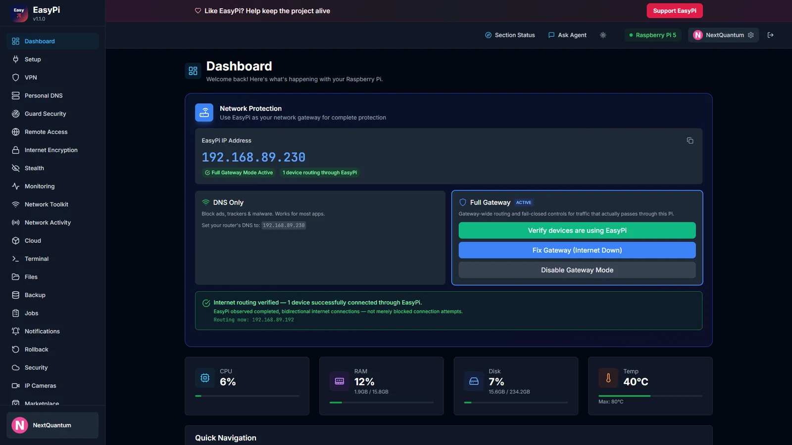
</p>

## What EasyPi brings together

| Area | Capabilities |
|---|---|
| **Guard Security** | NetProtection policies, PRISM traffic classification, Shadow Mode, heuristics, parental controls, schedules, per-device rules, and DNS activity |
| **Private connectivity** | WireGuard VPN, Tailscale remote access, Personal DNS, outbound Internet Encryption, and Chameleon Stealth |
| **Operations** | Live monitoring, network tools, jobs, notifications, encrypted backups, signed updates, and rollback snapshots |
| **Private services** | PiCloud, browser file management, encrypted files, IP cameras, recording, terminal access, and local Ollama chat |

## Guard Security and PRISM

Guard Security combines DNS policy with network observations. PRISM classifies traffic patterns, while Shadow Mode can observe proposed decisions before enforcement. The heuristics engine and new-domain analysis help identify unusual behavior, and administrators can apply parental-control rules and schedules to selected devices.

> Detection and filtering are best effort. Encrypted, novel, spoofed, or out-of-path traffic can evade classification. Device identity based on observed MAC and IP information is useful for administration but is not cryptographic authentication.

<p align="center">
  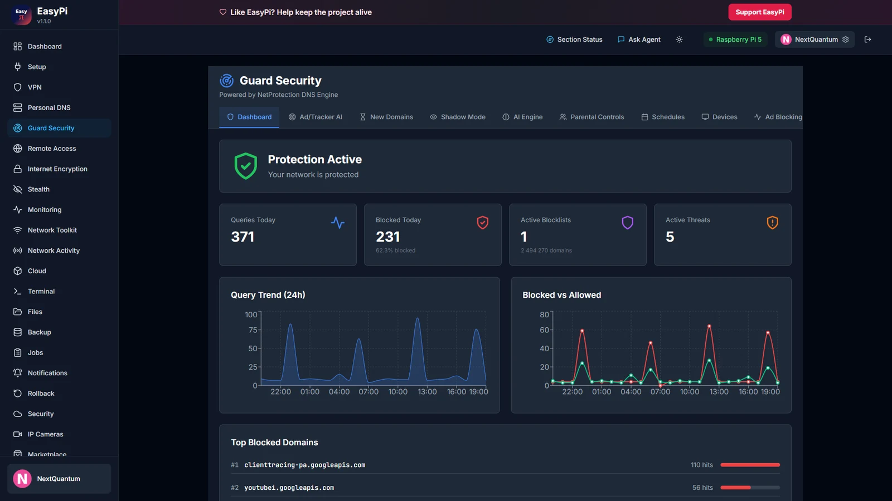
</p>

### Guard Security modules

### Shadow Mode

Observe detections and proposed actions before enabling enforcement. This gives administrators time to review how policies affect real traffic without immediately blocking requests.

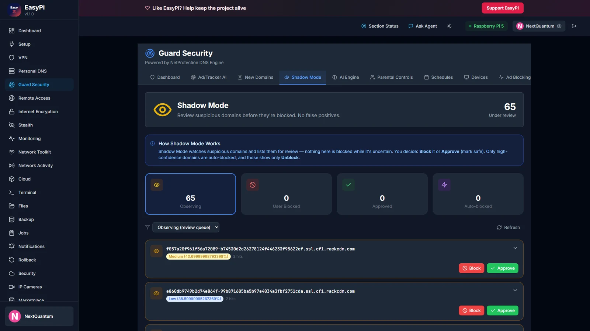

### PRISM heuristics

Review learned traffic behavior, confidence scores, anomalies, and heuristic findings. PRISM builds a local behavioral picture from traffic that passes through EasyPi and helps highlight activity that deserves attention.

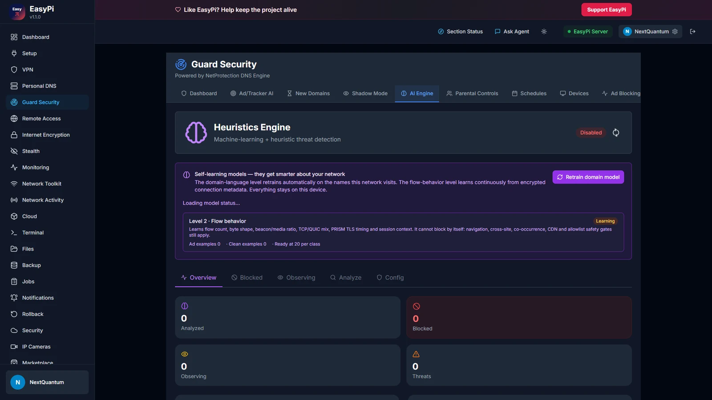

### Parental controls

Choose a known device, block selected content categories, set access rules, and create time schedules such as bedtime or study hours. Device identity follows observed network information, including MAC changes when EasyPi can correlate them safely.

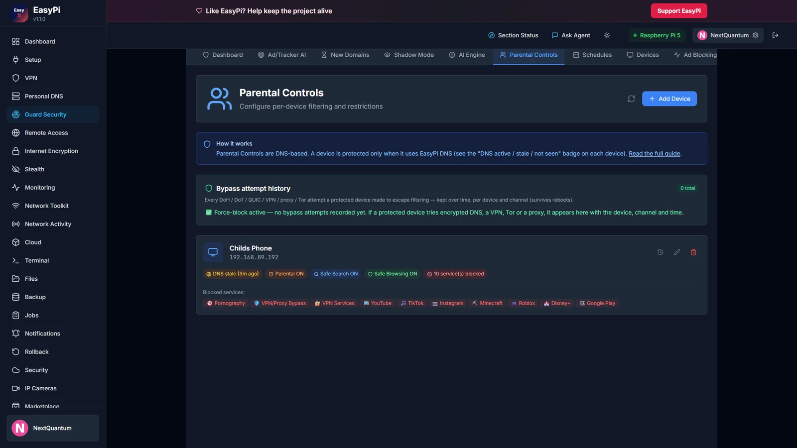

### Ad and tracker analysis

Inspect detected advertising and tracking activity, see what was blocked, and manage the policy used by protected devices.

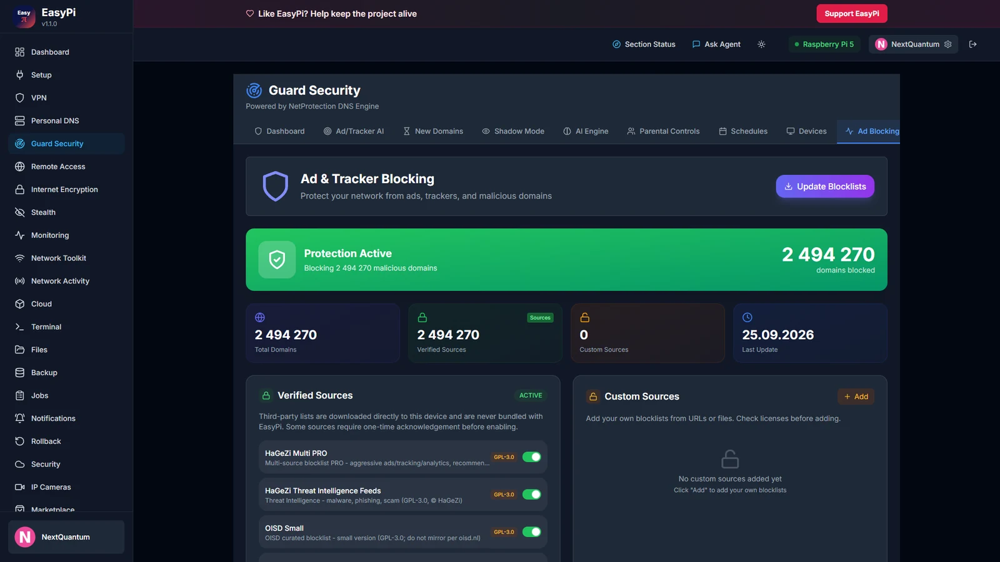

## Connectivity and privacy

EasyPi separates four different jobs clearly:

- **VPN Server** gives approved remote clients access through WireGuard.
- **Remote Access** uses Tailscale for authenticated access and subnet routing.
- **Internet Encryption** routes selected forwarded traffic through supported outbound VPN providers.
- **Stealth** uses Chameleon, a self-hosted encrypted tunnel designed to resemble ordinary HTTPS traffic and make basic DPI classification harder.

Chameleon is a single-hop tunnel between EasyPi and a user-controlled VPS. It encrypts selected forwarded traffic and uses fail-closed routing controls, but it does not promise anonymity or absolute undetectability.

<p align="center">
  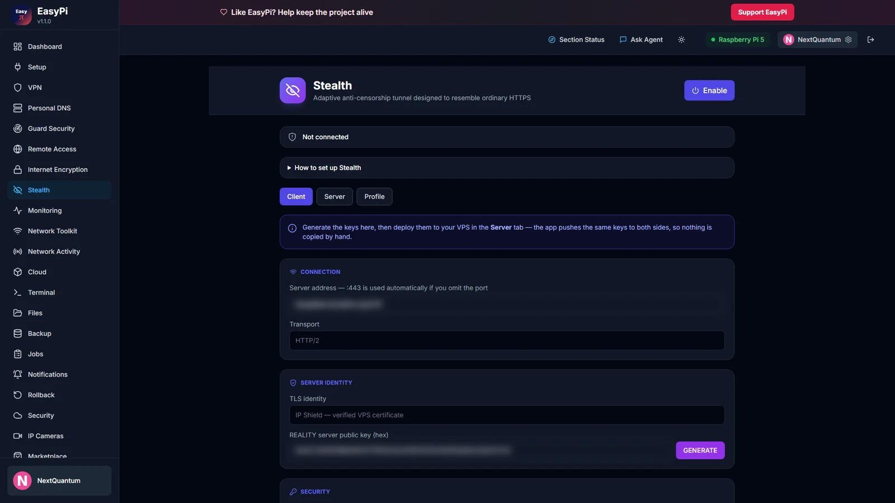
</p>

### Connectivity modules

### WireGuard VPN

Create and manage WireGuard clients for secure access to the home network. EasyPi displays the endpoint, server key, client list, and downloadable or QR-based client configuration.

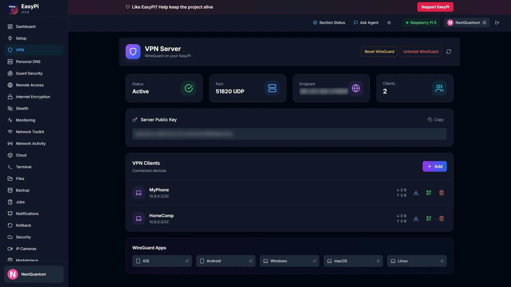

### Personal DNS

Deploy an encrypted DNS service to a supported VPS and use it through WireGuard, DNS-over-HTTPS, or DNS-over-TLS. The panel checks certificate and service status and shows the connection details required by client devices.

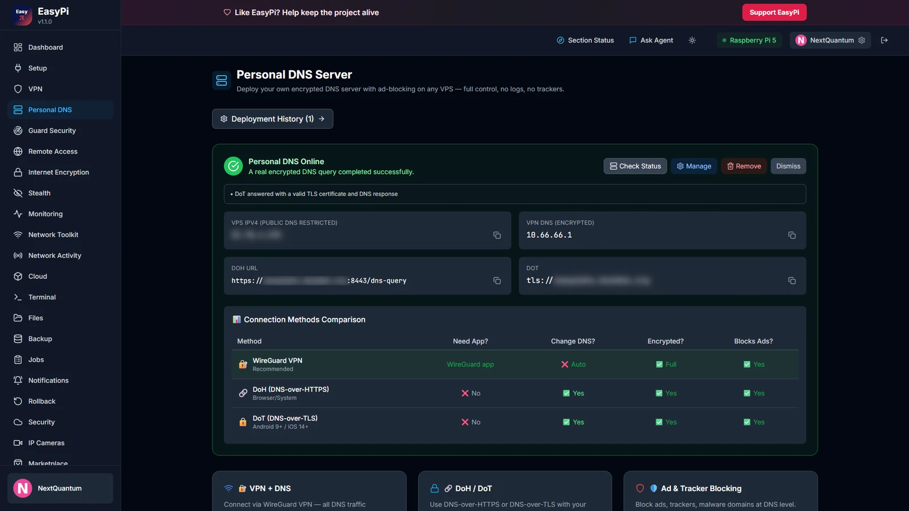

### Tailscale remote access

Connect EasyPi and personal devices through Tailscale without exposing the management panel directly to the public internet. Remote Access can advertise approved local subnets and show connected devices and routing state.

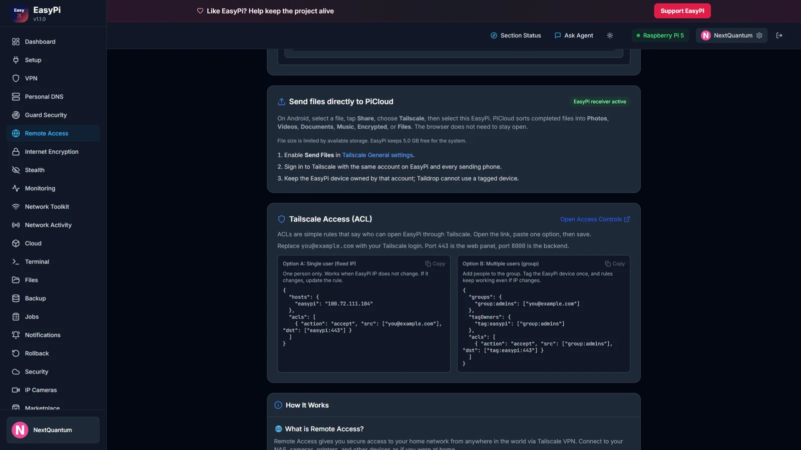

### Internet Encryption

Route selected forwarded devices through a supported outbound VPN provider. EasyPi controls the tunnel lifecycle, DNS handling, device selection, and fail-closed behavior for traffic assigned to the encrypted path.

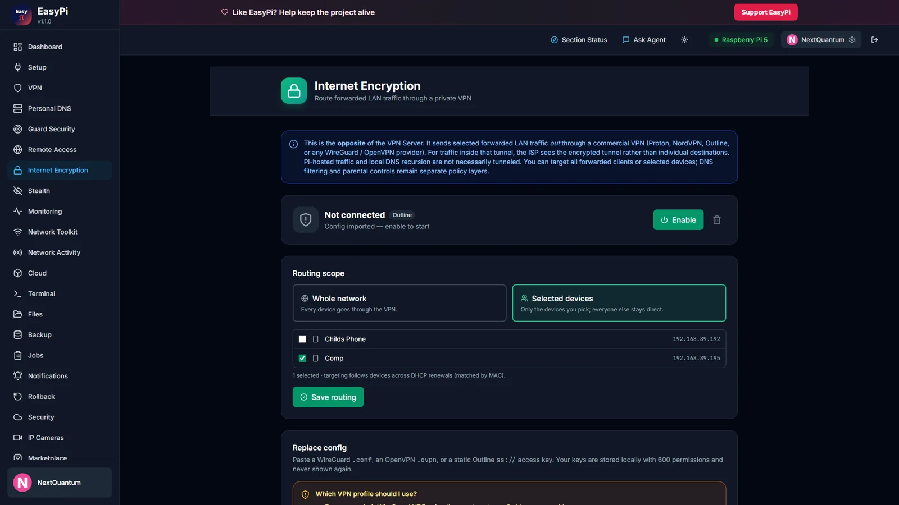

## Cloud, cameras, and local AI

PiCloud organizes uploads by type and supports client-side EPEC encryption. Small files can arrive through a Telegram bot, while larger files can use Tailscale Taildrop. EasyPi also manages RTSP cameras, live viewing, snapshots, recording, and retention. Ollama chat runs locally and receives a bounded documentation context about EasyPi rather than access to private files, secrets, or live system state.

<table>
  <tr>
    <td width="50%">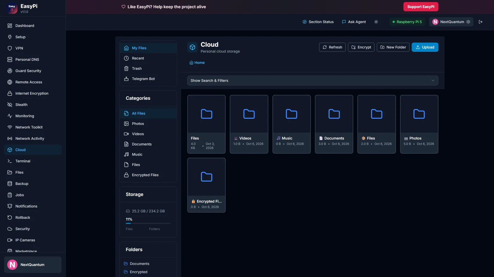</td>
    <td width="50%">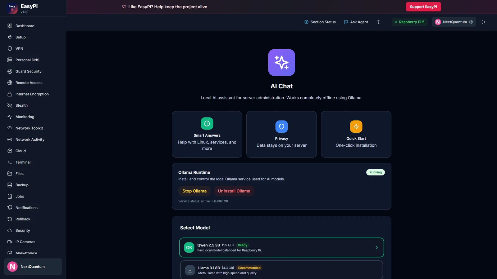</td>
  </tr>
  <tr>
    <td align="center"><strong>PiCloud</strong></td>
    <td align="center"><strong>Local AI chat</strong></td>
  </tr>
</table>

### IP cameras and recordings

### Camera management

Add an IP camera by address and credentials, let EasyPi test common RTSP paths, or enter the camera's path manually. The camera panel provides live viewing, snapshots, connection status, and PTZ controls when the camera supports them. Camera credentials are stored encrypted and are not shown again in the interface.

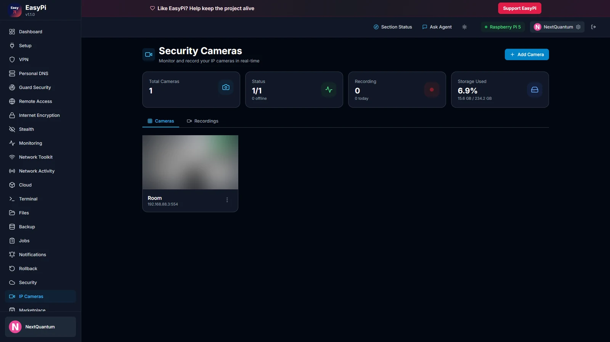

### Recordings

Record camera streams on the EasyPi storage, browse saved clips by camera and time, download recordings, and remove recordings that are no longer needed. Retention controls help limit how long recordings remain on disk so camera storage does not grow without bound.

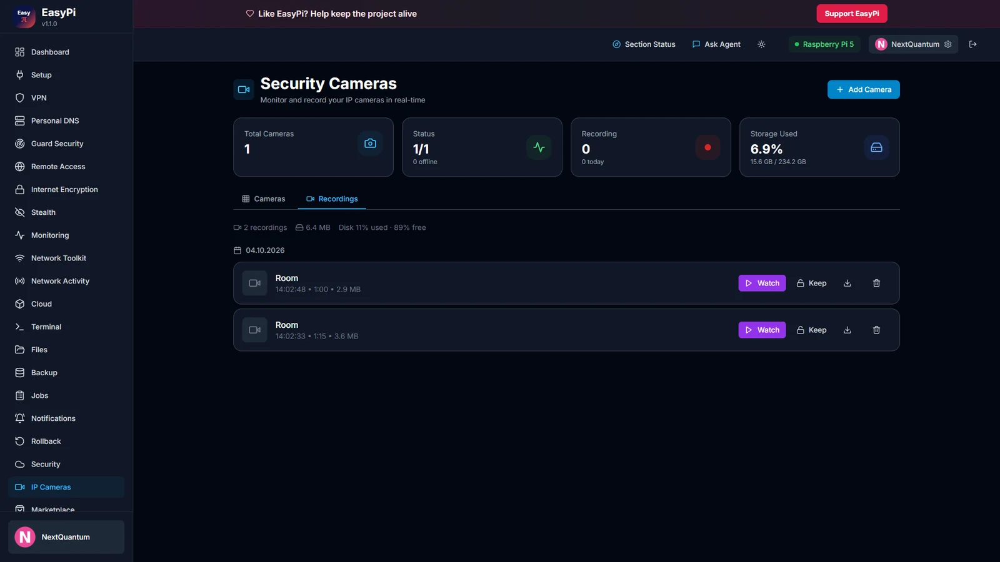

## Reliable operations

EasyPi includes live system monitoring, network activity, encrypted backups, background jobs, event notifications, signed update workflows, and rollback snapshots. State-changing network and system operations cross a narrow privileged boundary through root-owned, allowlisted jobs and systemd services.

<table>
  <tr>
    <td width="50%">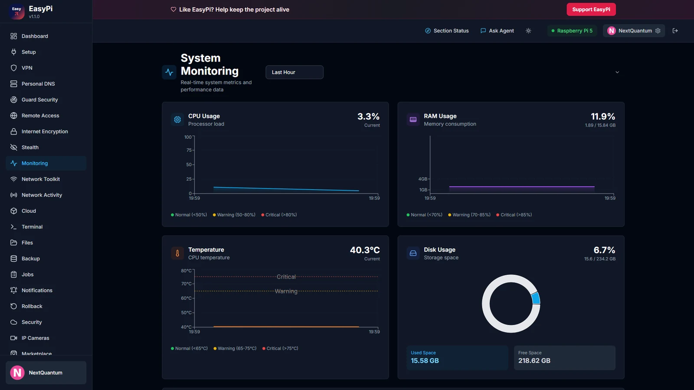</td>
    <td width="50%">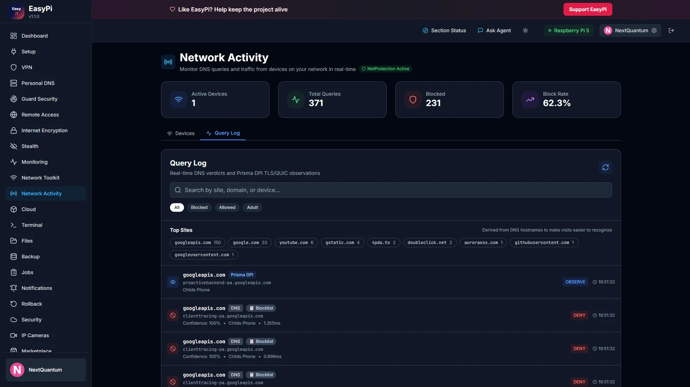</td>
  </tr>
  <tr>
    <td align="center"><strong>Monitoring</strong></td>
    <td align="center"><strong>Network activity</strong></td>
  </tr>
  <tr>
    <td width="50%">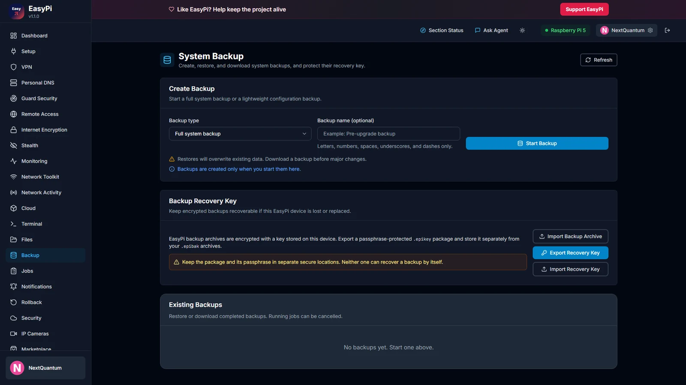</td>
    <td width="50%">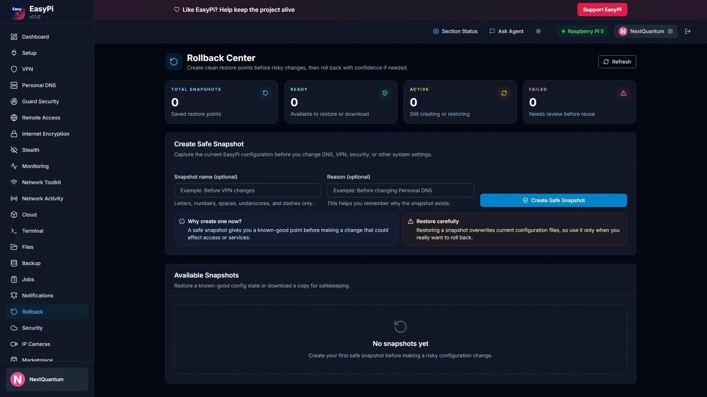</td>
  </tr>
  <tr>
    <td align="center"><strong>Encrypted backup</strong></td>
    <td align="center"><strong>Rollback</strong></td>
  </tr>
</table>

## Architecture

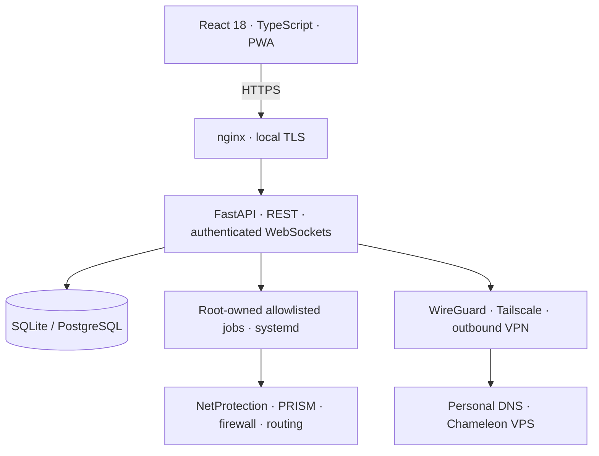

| Layer | Main components |
|---|---|
| **Browser** | React, TypeScript, Vite, Tailwind CSS, TanStack Query, Zustand, xterm.js, Recharts, and a service worker |
| **Application** | FastAPI, REST, authenticated WebSockets, SQLAlchemy, Alembic, SQLite, and PostgreSQL support |
| **Privileged boundary** | Root-owned allowlisted jobs and systemd units for updates, routing, capture, and service management |
| **Network engines** | NetProtection, PRISM, firewall and routing controls, WireGuard, Tailscale, and outbound VPN routing |
| **VPS and tunnels** | Verified SSH deployment workflows and the Go-based Chameleon client and server |

## Project principles

- **Self-hosted by default:** core management stays on hardware the owner controls.
- **Explicit trust boundaries:** the interface explains when traffic must pass through EasyPi and when a VPS or provider becomes part of the path.
- **Fail-closed where practical:** protected routes should not silently fall back to an unprotected path.
- **Recovery matters:** backups, rollback, console access, and clear deployment state are part of normal operations.
- **Honest status:** experimental or preview features are identified as such. The Marketplace is currently a read-only preview rather than an installer.

## Technology

`Python` · `FastAPI` · `React` · `TypeScript` · `Go` · `nginx` · `systemd` · `WireGuard` · `Tailscale` · `SQLite` · `PostgreSQL` · `Ollama`

## Installation

EasyPi currently targets **Raspberry Pi OS Lite 64-bit based on Debian Trixie** on `aarch64`.

```bash
grep VERSION_CODENAME /etc/os-release
uname -m

cd ~
wget -O easypi-full-aarch64-trixie.tar.gz \
  "https://github.com/NextQuantum/EasyPi/releases/latest/download/easypi-full-aarch64-trixie.tar.gz"
wget -O SHA256SUMS.txt \
  "https://github.com/NextQuantum/EasyPi/releases/latest/download/SHA256SUMS.txt"
sha256sum -c SHA256SUMS.txt

sudo mkdir -p /opt/EasyPi
sudo tar -xzf easypi-full-aarch64-trixie.tar.gz -C /opt/EasyPi
sudo chmod +x /opt/EasyPi/install.sh
sudo sed -i 's/\r$//' /opt/EasyPi/install.sh
sudo /opt/EasyPi/install.sh --binary
```

Open `https://easypi.local/` or the local address printed by the installer. EasyPi has no default credentials; the first-run flow creates the administrator account and provides a recovery token.

> EasyPi is under active development and can change routing, DNS, firewall rules, and system services. Keep console or SSH recovery access and make a backup before changing gateway or update settings.

## License

EasyPi is distributed under a proprietary license for personal, non-commercial home or lab use. See [LICENSE](LICENSE), [EULA.txt](EULA.txt), and [THIRD_PARTY_LICENSES.md](THIRD_PARTY_LICENSES.md).

<p align="center">
  Built by <strong>NextQuantum</strong> for Raspberry Pi owners who want one clear place to manage their system and network.
</p>


